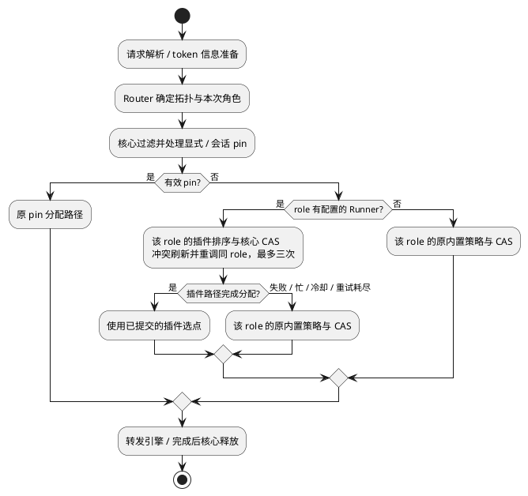
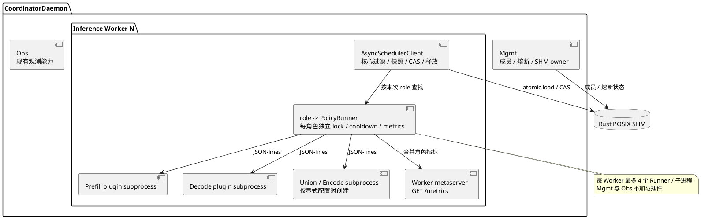
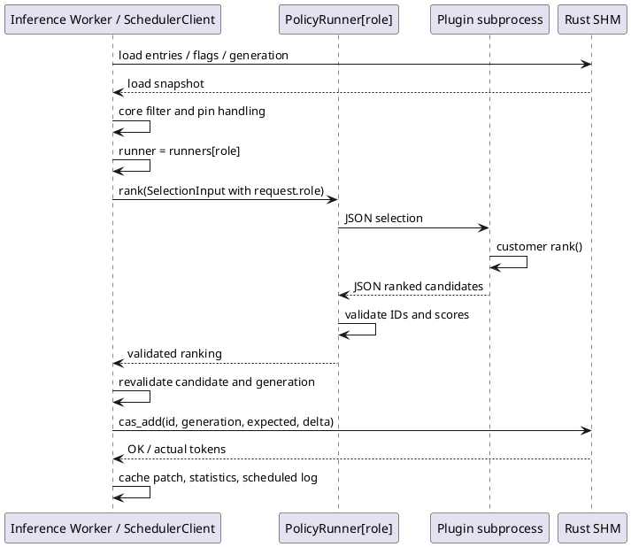
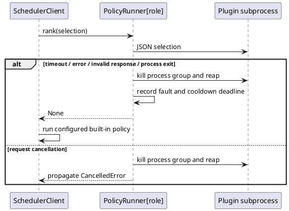

# Coordinator 候选实例 / Endpoint 选点插件设计

> 状态：PR !1434 的 API v2 选点扩展按角色独立配置与隔离执行；本版角色隔离路径需重新执行集群验收。
> 需求追踪：[Issue #844](https://gitcode.com/Ascend/MindIE-Motor/issues/844)。
> 本文描述当前实现，后续扩展在风险与演进章节单独列出。

## 1. 需求与目标

### 1.1 背景

Motor 已提供轮询、负载均衡、KV 亲和和动态分桶选点策略，Prefill 和 Decode 可分别配置。
增加客户算法需要修改核心源码、配置枚举或 Worker 选路分支，难以作为独立包交付和随版本升级保留。
本设计开放已经确定角色的候选实例/endpoint 选点，将客户算法与调度基础设施分开管理。

本文沿用 [Coordinator 调度热路径 Rust 重构](coordinator_scheduler_rust.md) 的职责边界：
Python 决定建议选点，Rust SHM 执行最终原子分配，Mgmt 管理成员与熔断状态。
[KV Conductor](kv_conductor.md) 继续提供 KV 索引和内置亲和策略需要的查询能力。

### 1.2 目标与验收口径

| ID | 目标 | 判定依据 |
|----|------|----------|
| R1 | 独立交付 | 按文档构建并安装客户 wheel，只改可选配置即可参与选点，无需修改或重建 Motor 源码 |
| R2 | 存量兼容 | 不配置插件时执行原有内置路径，原配置、过滤、pin、分配和释放语义保持 |
| R3 | 按角色独立与故障回退 | P/D 可使用不同插件名或参数；某角色加载失败、异常、超时、崩溃、非法输出或繁忙时，仅该角色使用原配置的内置策略 |
| R4 | 可观测与一致性 | 加载、故障和回退有日志指标；插件结果不能绕过核心约束或修改负载账本 |

R3 的请求成功率验收以前端请求有效、后端可用且原内置策略能够调度为前提。
不能把调度器测试通过等同于集群端到端成功率或吞吐已经达标。

### 1.3 范围与非目标

本版只开放候选排序。Router 拓扑选择、角色/引擎能力检查、熔断、优先级准入、负载公式、CAS 和释放由核心管理。
显式指定实例、精度探针及有效会话亲和 pin 优先执行，不调用插件。

不开放混部/PD 跨拓扑分流、多阶段分桶/筛选插件链、客户熔断器或客户记账公式。
本版也不增加热加载、远程策略服务、Rust 插件接口或专供插件的 KV Conductor 查询。

## 2. 现有路径与扩展位置

扩展位于角色内选点与原子分配之间，整体流程如下；CAS 细节见第 8 节：



PD 分离请求可能分别进行 P、D 选点，插件看到的是本次角色的候选池，不是任意角色混合的全局资源池。
例如短请求选择混部、长请求选择 PD 分离，需要额外的拓扑决策扩展，不属于本版。

## 3. 总体架构与职责

### 3.1 进程和数据流



插件进程通过当前 Python 解释器启动，安装环境与 Worker 一致。
`SchedulerConnectionManager.from_config()` 只在 `worker_index` 非空时传入插件配置，Mgmt/Obs 不预加载插件。
Worker 的 `connect()` 阶段并发预加载全部已配置角色，`disconnect()` 阶段并发关闭全部 Runner。
配置缺省或 `[]` 时不创建 Runner/子进程；列表项不能用空名称表示禁用。

### 3.2 所有权与不可越过的边界

| 对象或动作 | 所有者 | 插件得到什么 |
|------------|--------|--------------|
| 请求及角色、引擎和 dispatch 约束 | Router / SchedulerClient | 本次请求的有限元数据 |
| 成员、熔断和有效 endpoint | Mgmt / Worker 核心 | 经过核心过滤的候选标识与状态特征 |
| 实时负载 | Rust SHM，Worker 读取后构造快照 | 数值副本，不提供 SHM 句柄 |
| KV 命中索引 | KV Conductor | 本版不提供命中查询；可读取已有缓存使用率 |
| 建议排序 | 客户策略 | 返回合法候选子集及分数 |
| 最终分配、负载 delta、释放 | Worker 核心 + Rust CAS | 无写权限，不接受插件提交的 delta |
| 插件实例与私有状态 | 插件子进程 | 每 Worker、每角色独立；同名入口也分别构造，不共享插件对象或私有状态 |

### 3.3 代码组织

| 文件 | 职责 |
|------|------|
| `motor/config/coordinator.py` | `PolicyPluginConfig`、`normalize_policy_plugins()`、角色数组校验与配置错误传播 |
| `motor/coordinator/scheduler/policy/api.py` | 公共 DTO 和 `LoadBalancingPolicy` |
| `motor/coordinator/scheduler/policy/plugin_worker.py` | 精确发现 Entry Point、加载校验、协议服务 |
| `motor/coordinator/scheduler/policy/plugin_runner.py` | 有界调用、输出校验、回收、冷却恢复和指标 |
| `motor/coordinator/scheduler/runtime/scheduler_client.py` | 展开 role→Runner、并发生命周期、快照、同角色 CAS 重选与内置回退、指标合并 |
| `motor/coordinator/scheduler/runtime/scheduler_connection_manager.py` | 按进程身份传入配置 |
| `motor/coordinator/api_server/inference_server.py` | Worker 插件指标抓取口 |
| `examples/scheduler_plugin/` | 独立 wheel 示例 |
| `tests/coordinator/scheduler/test_policy_plugin.py` | 插件契约和集成回归 |

## 4. 关键设计决策

| 决策 | 当前选择 | 原因与代价 |
|------|----------|------------|
| 扩展范围 | 角色内候选排序 | 维持 Router 与分配边界，客户不能绕过核心兼容性检查 |
| 发现方式 | 已安装包的 Entry Point | 按名称配置，不接受配置中的任意源码文件路径；包仍需部署系统安装 |
| 执行位置 | 独立 Python 子进程 | 可回收阻塞代码；新增 IPC 和解释器开销，不是安全沙箱 |
| 通信 | 有界 JSON-lines | 只传公共数据，不使用 pickle；不传递活的内部对象 |
| 并发 | 每 Worker、每角色一次在途排序，忙时仅该角色回退 | 避免无界排队；P 与 D 不共用执行锁，最多四个子进程 |
| 回退目标 | 当前角色原配置的内置策略 | 保留客户已有 P/D 策略选择，不统一强制切为负载均衡 |
| CAS 冲突 | 刷新快照后重调同一插件 | 不盲目提交旧排序第二名；插件选点最多尝试三次 |
| 未配置路径 | 保留现有内置实现 | 降低兼容风险；本版未将四种内置算法全部迁到 `rank()` |
| API 版本 | v2 | 与历史分支的进程内 v1 草案区分，不把不同上下文当成兼容接口 |

线程等待超时只能让调用方停止等待，不能可靠终止阻塞的 Python 客户代码，因此本版采用可回收进程。
当前回收使用 `start_new_session=True`、`os.killpg` 和 `SIGKILL`，目标运行环境为 POSIX；尚未提供 Windows 回收分支。

## 5. 公共接口与上下文

### 5.1 策略契约

继承 `motor.coordinator.scheduler.policy.api.LoadBalancingPolicy`，声明 `api_version = 2`，
实现同步 `rank(selection: SelectionInput) -> Sequence[RankedCandidate]`。
构造函数接受 `options` JSON 对象；插件可维护私有状态，但进程重启后不会保留，多个 Worker 或角色之间也不共享。相同 Entry Point 可以用于多个角色，但各项 options、预算和运行状态独立。

返回非空候选子集，顺序就是优先顺序；分数约定越小越优，核心不会再按分数排序。
返回空列表不是拒绝请求的机制，而是触发内置回退。插件不能借此实现强制租户准入或安全隔离。

### 5.2 DTO 与数据来源

所有 DTO 为 `frozen=True` 的 dataclass，经过序列化在子进程中重建。

| DTO | 字段 | 来源与语义 |
|-----|------|------------|
| `CandidateId` | `instance_id`, `endpoint_id` | 本次核心候选标识，必须是整数且不是 bool |
| `RequestContext` | `request_id`, `role`, `model_name` | 请求 ID、角色字符串、请求模型 |
| `RequestContext` | `prompt_tokens`, `max_output_tokens` | 已有 token IDs 的数量；最大输出优先取 `max_completion_tokens`，再取 `max_tokens` |
| `RequestContext` | `user`, `session_id` | 可选请求元数据；缺省为 None |
| `CandidateSnapshot` | `id`, `active_tokens`, `instance_active_tokens` | endpoint 和实例的当前负载副本 |
| `CandidateSnapshot` | `node_address`, `engine_type`, `kv_cache_usage` | endpoint IP、引擎类型、已有缓存使用率或 None |
| `SelectionInput` | `request`, `candidates`, `excluded`, `attempt` | 请求、候选 tuple、已排除 ID 集合和从 0 开始的选点次数 |
| `RankedCandidate` | `id`, `score` | 候选标识与有限数值分数 |

`prompt_tokens=0` 也可能表示尚未获得 token IDs，不应直接理解为空请求。
`node_address` 当前是 endpoint IP，在 Pod 网络或代理后不一定表示物理宿主机。
user/session 信息不是认证身份，插件不能据此宣称完成了安全租户隔离。
本版不暴露原始请求正文、token IDs、凭据、内部 Client 或可写 SHM 句柄。

### 5.3 输出校验

父进程检查响应是否为非空列表、长度是否超过输入候选数、ID 是否属于允许集合、是否重复或被排除，
并拒绝 bool ID、bool 分数和非有限分数。非法结果通过 Runner 故障路径回退。
核心随后重新验证候选可用性和成员 generation，再通过 CAS 校验提交条件。
候选快照是读取时刻的视图，不是锁定整个集群的事务快照，也不保证插件返回全局最优解。

## 6. 配置、注册与加载

### 6.1 配置入口

在 `motor_coordinator_config.scheduler_config` 下配置可选列表。每项将**一个或多个角色**映射到一个插件入口，列表顺序不决定调度优先级：

```json
{
  "prefill_scheduler_type": "kv_cache_affinity",
  "decode_scheduler_type": "load_balance",
  "policy_plugin": [
    {
      "role": ["prefill"],
      "name": "acme.prefill_weighted",
      "options": {"instance_weight": 0.05},
      "timeout_ms": 50,
      "startup_timeout_ms": 5000,
      "cooldown_seconds": 30
    },
    {
      "role": ["decode"],
      "name": "acme.decode_weighted",
      "options": {"instance_weight": 0.2},
      "timeout_ms": 100,
      "startup_timeout_ms": 5000,
      "cooldown_seconds": 10
    }
  ]
}
```

上例演示 P/D 使用不同入口名；示例包默认只注册 `acme.weighted_load`，上述两个名称需按第 6.2 节额外注册。
若 P/D 使用同名 `acme.weighted_load` 且参数和预算相同，可合并为一个配置项：

```json
{
  "policy_plugin": [
    {"role": ["prefill", "decode"], "name": "acme.weighted_load", "options": {"instance_weight": 0.05}}
  ]
}
```

一项复用的是配置，仍会创建两个独立策略实例；需要不同 options 或预算时拆为两项。
Union 不继承 Prefill 的插件配置；要在混部路由启用插件，必须在某项的 `role` 数组中显式添加 `"union"`。Encode 同理。

| 字段 | 默认值 | 校验与作用 |
|------|--------|------------|
| role | 无，必填 | 非空字符串数组，仅允许 `prefill` / `decode` / `union` / `encode`；项内重复和跨项角色重叠均报错，不接受字符串简写 |
| name | 无，必填 | 非空字符串，最多 128 个字符；按 Entry Point 精确匹配，空白名称非法 |
| options | `{}` | 可 JSON 序列化的对象，不允许 NaN/Infinity；只传给该角色策略的构造函数 |
| timeout_ms | 50 | 该角色单次排序交换的等待预算，整数 1–60000 毫秒，不接受 bool |
| startup_timeout_ms | 5000 | 该角色启动握手的等待预算，整数 1–60000 毫秒，不接受 bool |
| cooldown_seconds | 30 | 该角色故障后恢复冷却期，有限数值且至少 1 秒，不接受 bool |

未配置和 `[]` 等价，全部使用内置路径；显式 `null` 不是禁用写法，应报类型错误。展开后最多四种角色，每种角色只能对应一个配置项。外层列表最多四项。
非列表、非对象列表项、缺少 role/name、未知键、非法角色或数值均为配置错误，不能被当成插件不可用而静默禁用。
修改列表、名称、options 或预算后需重启 Worker，不支持热加载或运行中安装后自动发现。

`prefill_scheduler_type` 继续决定 P/U/E 的默认与回退策略，`decode_scheduler_type` 决定 D 的默认与回退策略。
因此只配置 Prefill 插件时，Decode、Union 和 Encode 仍直接运行各自内置策略。

### 6.2 包注册与启动校验

示例包在 `pyproject.toml` 中注册：

```toml
[project.entry-points."mindie_motor.scheduling_policies"]
"acme.weighted_load" = "acme_motor_policies:WeightedLoadPolicy"
```

同包可额外注册两个名称指向同一示例类，供第 6.1 节配置使用；这是插件包作者需要新增的元数据，并非当前示例 wheel 已有入口：

```toml
[project.entry-points."mindie_motor.scheduling_policies"]
"acme.prefill_weighted" = "acme_motor_policies:WeightedLoadPolicy"
"acme.decode_weighted" = "acme_motor_policies:WeightedLoadPolicy"
```

两个入口也可以由客户包注册为不同类；Motor 只依赖公共 API 与配置名，不要求 P/D 算法相同。

Loader 只导入与配置名完全匹配的条目。零条或多条匹配均失败，并检查：
对象是 `LoadBalancingPolicy` 子类、API 版本为 2、重写了同步 `rank()`，然后执行构造函数。
历史 API v1 插件不会被当成 v2 接受；未选中的入口不会执行 `.load()`。
包需安装在 Worker 使用的 Python 环境，Motor 与插件版本由部署系统共同锁定。
完整实现和 wheel 构建安装步骤见 [示例包](../../../examples/scheduler_plugin/README.md)。 从零接入步骤见[中文快速接入指南](../user_guide/features/scheduler_policy_plugin.md)。

### 6.3 按角色插件的实现分解

实现链路如下，扩展角色配置时应同时检查各层，不能只修改 JSON 示例：

| 层 / 关键入口 | 实现职责与不变量 |
|--------------|------------------|
| `motor/config/coordinator.py`：`PolicyPluginConfig.validate()`、`normalize_policy_plugins()` 与 `CoordinatorConfig.from_json()` | 把 JSON 对象项转换为配置实例，验证字段、未知键、role 非空数组、项内重复与跨项角色重叠；规范化保留每项的 role 数组，Client 再展开。非法配置须让调用方明确失败，不能被通用异常处理变成默认空配置 |
| 同文件：`SchedulerConfig.policy_plugin`、`SchedulerConfig.__post_init__()` 与 `CoordinatorConfig.validate_config()` | 默认空列表；直接构造和 JSON 加载都验证完整列表，限制每种实际角色只能归属一项 |
| `scheduler_connection_manager.py`：`SchedulerConnectionManager.from_config()` | 只向 Inference Worker 的 `SchedulerClientConfig` 传递配置；Mgmt/Obs 不创建客户 Runner |
| `scheduler_client.py`：`AsyncSchedulerClient.__init__()` | 建立 `dict[role, PolicyRunner]`，逐项遍历 role 数组，按角色构造 `PolicyRunner(item, role=role)`；索引键为角色，不能以 name 或配置项去重合并 |
| 同文件：`connect()` / `disconnect()` | 并发预加载全部配置角色，并发回收全部 Runner；单个加载失败由该 Runner 进入冷却，不阻止其他角色可用 |
| 同文件：`select_and_allocate()`、`_try_rank_external_policy()`、`_rank_external_policy()` | pin 优先；按本次 role 获取 Runner，快照、插件调用、fallback 计数和 CAS 重选始终归属同一角色；缺少映射直接走 base |
| `plugin_runner.py`：`start()` / `rank()` / `close()` / `_restart()` | 每实例维护进程、互斥锁、冷却期限、至多一个恢复任务和指标；P 的故障/繁忙不会占用 D 的锁或重置其进程 |
| `scheduler_client.py`：`policy_metrics_text()`；`PolicyRunner.metrics_text()` | 输出各 Runner 的 `{policy,role}` 样本，按 metric family 分组，每组的 `# TYPE` 元数据只出现一次 |
| `tests/config/`、`tests/coordinator/scheduler/test_policy_plugin.py` | 拦截非法 schema、角色路由、同名独立性、故障隔离、并发生命周期与合并指标回归；执行矩阵见第 13 节 |

这一实现不改变 API v2：`SelectionInput.request.role` 已携带角色，`rank()` 签名与子进程排序消息不需要升级版本。
配置角色负责选择 Runner，请求上下文角色用于让客户算法理解此次选点，两者必须一致。

### 6.4 旧单对象配置迁移

PR !1434 尚未合入，旧单对象 `roles` 草案不作为兼容格式保留。加载时应报明确迁移错误，而非自动拆分或忽略。
以下旧配置不可继续使用：

```json
{
  "policy_plugin": {
    "name": "acme.weighted_load",
    "roles": ["prefill", "union"],
    "options": {"instance_weight": 0.05}
  }
}
```

需把外层对象改为列表，并将 `roles` 改名为 `role`；数组中的角色仍可复用同一项配置：

```json
{
  "policy_plugin": [
    {"role": ["prefill", "union"], "name": "acme.weighted_load", "options": {"instance_weight": 0.05}}
  ]
}
```

禁用全部插件改为删除 `policy_plugin` 或设为 `[]`；禁用某角色则从 role 数组移除该角色（数组空时删除整项），不能填写空 name。
此迁移只影响本 PR 的插件草案配置，原内置 `scheduler_type` 的迁移机制继续有效。

## 7. 进程协议与调用时序

### 7.1 JSON-lines 协议

首条请求为 `{name, options}`，成功响应为 `{"ready": true}`；后续请求为序列化的 `SelectionInput`。
排序响应为 `{"ranked": [{"id": {"instance_id": 1, "endpoint_id": 0}, "score": 3.0}]}`，
子进程异常返回 `{"error": "异常类型: 说明"}`。DTO 的 tuple/frozenset 在 wire 上表示为 JSON 数组。

单条输入或输出的限制常量为 `MAX_MESSAGE_BYTES = 1024 * 1024`。
父进程检查编码长度和读取上限，子进程也限制消息；错误说明截取至 512 个字符。
同一进程一次只有一个请求在途，因此不依赖请求队列或额外响应复用编号。
取消或超时后丢弃并回收该进程，避免迟到响应被下一请求消费。

启动固定代码先保留协议 stdout，再在导入 Motor 和客户模块之前把普通 stdout 重定向到 stderr。
这样 Motor 导入日志、客户模块和构造函数的普通输出不会被误读成 JSON。

### 7.2 一次成功选点



如果核心已经确定有效 pin，则直接走原分配路径，不进入图中的插件调用。
成功返回给 Router 后，转发与请求结束时的释放仍走原有链路。

## 8. 快照、CAS 与账本一致性

### 8.1 为什么保存插件决策时的负载

插件通过异步 IPC 执行期间，其他请求可能更新同一 endpoint 的缓存和 SHM。
例如发给插件的负载是 20，等待期间变成 30：若把 30 作为 expected 提交，就可能在未重新评分的情况下接受旧决策。
因此核心保存输入快照中的 active_tokens，用它作为 CAS expected；不从等待后的可变 Endpoint 对象重新取 expected。

同时记录输入候选的 generation。插件返回后若槽位成员 generation 已变化，放弃结果并走内置策略。
随后核心的候选检查和 Rust CAS 再校验身份、generation、BLOCKED 及 expected 条件。

### 8.2 冲突重选与回退

| 结果 | 核心行为 |
|------|----------|
| OK | 记录实际提交值，更新 Worker cache、DP 统计并返回资源 |
| Changed | 刷新 SHM 负载，以同一角色的 Runner 重新排序 |
| Blocked / SlotInvalid，或候选复核失败 | 排除该候选，刷新后重调插件 |
| generation 复核变化 | 放弃插件结果，回到内置策略 |
| 插件第三次选点之后仍需重试 | 记录 `cas_retry_limit`，以 `_use_plugin=False` 重新进入原内置路径 |
| 其他 CAS 错误 | 沿用核心调度失败路径，不伪装成插件成功 |

插件初选和重选合计最多三次。回退时不沿用插件的排序或候选子集，核心重新执行原路径，
并保留角色、引擎类型、dispatch 能力等原始约束；不会再次递归启用插件。

### 8.3 提交与释放

插件分数只用于排序语义和日志，不能作为负载 delta。
插件成功时使用 `calculate_demand_workload(role, req_info)`，既不因原配置是轮询而提交零负载，
也不采用内置动态分桶专属的账本单位。回退时恢复对应内置策略原有公式，包括 KV 亲和提交量。
释放使用核心记录的 committed workload，通过既有 `update_workload()` / `cas_sub_floor0` 路径完成。

## 9. 并发、超时与生命周期

### 9.1 执行状态

实现没有独立状态枚举；下表根据进程、锁、冷却时间和关闭标志解释可观察状态。

| 状态 | 请求行为 | 后续动作 |
|------|----------|----------|
| 禁用或角色未启用 | 原内置策略 | 不加载客户代码 |
| 启动 / 后台恢复中 | 忙时立即回退 | 完成加载握手或进入冷却 |
| 就绪且空闲 | 一次插件排序 | 合法响应返回；失败则回收并冷却 |
| 已有排序在途 | 立即回退，不排队 | 不终止正在服务其他请求的插件调用 |
| 冷却期 | 立即回退 | 到期后的请求触发至多一个后台恢复任务 |
| 正在关闭 / 已关闭 | 不再启动插件 | 取消恢复任务、终止进程并等待回收 |

一个客户算法实例只服务一个 Worker 的一个角色。同名入口在 P/D 配置中各构造一次，
不共享状态、锁、冷却、恢复任务或指标。P 阻塞/冷却时 D 仍可排序；同角色后续请求忙时立即回退。
策略内部计数器和轮询位置不能据此宣称跨 Worker 或跨角色全局公平。
进程退出后私有状态丢失，客户算法需要允许重新构造。

### 9.2 预算的准确含义

`startup_timeout_ms` 约束启动消息交换的等待，覆盖握手期间的加载和构造；不包含之前创建 OS 子进程的整个耗时。
`timeout_ms` 约束一次排序消息交换等待。DTO 转换、同步 JSON 编解码/校验和进程回收仍有开销，
同步 Python 工作也不能被 asyncio 计时器强制抢占，因此这不是整次调度或端到端请求的硬时限。
一次角色分配至多消耗三次该角色插件排序预算，之后执行内置策略自己的重试逻辑。
不同角色预算分别计算；多角色请求的端到端耗时还受拓扑时序和引擎处理影响。

### 9.3 失败、取消与回收



Runner 故障会回收进程并设置冷却期限；繁忙回退、快照构建失败、成员变化或 CAS 重试耗尽不等同于 Runner 故障，
不会因此自动重启一个正常进程。请求取消会终止在途进程并传播取消信号，不转换成成功回退，也不设置新的故障冷却期限。
Worker 正常关闭时并发关闭全部角色 Runner；每个 Runner 先取消自己的后台恢复，再中断在途调用、回收子进程，
不等待长达 60 秒的客户排序预算结束。`connect()` 并发预加载也避免把多个角色的启动预算串行累加。
若 Worker 数为 N、配置角色数为 K，则健康状态最多有 N×K 个插件子进程，0≤K≤4；
同一角色恢复前先回收旧进程，不建立额外执行池。每进程解释器和客户包的内存/CPU 开销需纳入部署容量评估。
本版不保证 Worker 被 SIGKILL 后阻塞插件进程的自动回收，也不提供对任意客户派生进程的安全隔离。

## 10. 异常与降级矩阵

| 场景 | 回退结果 | 进程处理 / 观测 |
|------|----------|-----------------|
| 配置类型或预算非法 | 配置校验报错 | 不作为可忽略的客户算法故障 |
| Entry Point 缺失、重名、版本不兼容、导入/构造失败 | 内置策略继续服务 | 加载告警、`load_errors`、回收与冷却 |
| `rank()` 异常、空/非法输出、响应断开或超限 | 内置策略 | `errors` 和 `fallbacks`，回收与冷却 |
| 排序交换超时 | 内置策略 | `timeouts` 和 `fallbacks`，回收与冷却 |
| 子进程繁忙或冷却 | 内置策略 | 每次增加 `fallbacks`，不逐请求重复故障告警 |
| 快照构建失败、无插件候选、成员变化 | 原核心路径重新选择 | 核心侧回退原因日志与 `fallbacks` |
| CAS 重选三次耗尽 | 原内置重试路径 | `cas_retry_limit` 回退日志与计数 |
| 请求取消 | 继续取消 | 回收进程，取消不计为插件异常或成功回退 |
| 内置策略也没有可用后端 | 原调度失败 | 不承诺后端不可用时请求成功 |

## 11. 日志与指标

### 11.1 日志

Worker 加载日志记录角色、名称和 API 版本；子进程输出发行包、包版本及 Entry Point 对象。
故障告警包含角色、插件名、异常类型和截断说明；核心侧回退记录 `membership_changed`、`cas_retry_limit` 等原因。
成功选点日志沿用 `scheduled`，策略名称为 `plugin:<name>`；回退成功时显示实际内置策略名。
普通客户输出进入子进程 stderr，不作为响应协议。客户异常说明仍需避免包含敏感请求内容。

### 11.2 指标语义与抓取

Worker metaserver `GET /metrics` 暴露进程内样本，标签为配置中的 `policy` 名称与 `role`。
例如同名插件的 `{policy="acme.weighted_load",role="prefill"}` 与 `role="decode"` 分别计数，不能合并为一个 Runner。
合并文本按指标 family 分组，每组的 `# TYPE` 声明只输出一次，后面连续跟各角色样本。

| 指标 | 含义 |
|------|------|
| `motor_policy_loads_total` | 成功完成加载握手的次数，含恢复 |
| `motor_policy_load_errors_total` | 启动失败次数，包含启动握手超时 |
| `motor_policy_calls_total` | 实际进入插件排序调用的次数，含 CAS 重选，不含繁忙/冷却跳过 |
| `motor_policy_errors_total` | 排序异常、协议或输出校验错误次数 |
| `motor_policy_timeouts_total` | 排序消息交换超时次数，不含启动超时 |
| `motor_policy_fallbacks_total` | Runner 或核心侧插件回退次数，不等于整个服务的请求失败数 |
| `motor_policy_selection_seconds_sum/count` | 排序调用累计耗时和次数，含失败与取消；不提供 quantile |

排序耗时从 Runner 进入调用开始，覆盖 DTO 转换、交换、校验和故障清理；不包含启动握手和繁忙直接回退。
一条 PD 请求可能有多个角色分配，CAS 也可能重复排序，不能用调用次数直接代替请求数或成功请求数。

应逐个抓取 `worker_metaserver_base_port + worker_index`，Obs 不聚合这些样本。
监控系统需保留 Worker 抓取目标身份后再汇总。禁用 metaserver 时没有此插件指标抓取口；
接入时需配置对应网络访问，沿用该端口现有的无 API key / 无 inference TLS 行为。

## 12. 兼容与交付

未配置插件时保留原内置实现，不执行 Entry Point 发现，也不启动插件子进程。
Prefill/Decode 的现有配置、旧 `scheduler_type` 的迁移逻辑、KV 亲和及动态分桶参数继续有效。
有效 pin 和会话亲和的优先级不因配置插件而变化。

示例 `acme.weighted_load` 按 `active_tokens + instance_weight * instance_active_tokens` 排序，
支持在存在匹配候选时优先选择 `preferred_node`。这是示例算法，不是内置负载均衡的行为等价替代。
安装在 Worker 的同一 Python 环境，重启后生效；部署和回滚应同时管理 Motor API 版本、插件包和配置。
从配置移除对应角色并重启 Worker 可恢复该角色原策略路径，运行中故障则走前述自动回退。

## 13. 测试与验收

### 13.1 契约与集成测试

| 验证对象 | 现有专项用例 |
|----------|--------------|
| 真实包发现、构造输出不污染协议、排序与退出回收 | `test_real_entry_point_ranks_and_shutdown_reaps_child` |
| 持续异常、阻塞、崩溃、空/非法结果与冷却 | `test_repeated_plugin_failure_is_bounded_and_cools_down` |
| 加载失败和加载阻塞 | `test_missing_and_hung_loader_fall_back` |
| 繁忙、取消和迟到响应隔离 | `test_busy_call_falls_back_and_cancellation_discards_late_reply` |
| 默认配置、角色范围、pin 和已有策略分配 | `test_plugin_config_json_and_existing_config_defaults`、`test_pins_and_role_scope_preserve_core_selection`、`test_disabled_plugin_keeps_builtin_allocations` |
| 冲突刷新、expected 快照与成员变化 | `test_cas_conflicts_reinvoke_plugin_with_fresh_snapshot`、`test_plugin_uses_decision_snapshot_for_cas_expected`、`test_membership_change_while_ranking_falls_back` |
| 失败后恢复、关闭时中断阻塞调用 | `test_shutdown_interrupts_busy_plugin_and_cooldown_recovers` |
| 真实 SHM CAS 分配及释放 | `test_real_plugin_with_native_shm_allocation_and_release` |
| 指标抓取 | `test_worker_metaserver_exposes_plugin_metrics` |
| 同项 P/D 的异常、超时、繁忙和冷却隔离、全部子进程回收 | `test_shared_config_keeps_other_role_healthy_and_reaps_all_children` |
| P/D 不同参数和同名插件指标分组 | `test_prefill_and_decode_use_their_own_plugin_options`、`test_same_name_role_configs_get_independent_runners` |

```bash
bash tests/run_tests.sh --serial tests/coordinator/scheduler/test_policy_plugin.py
bash tests/run_tests.sh --serial tests/coordinator/scheduler/ tests/coordinator/core/test_config.py tests/config/
```

先执行专项，再执行模块与配置回归。原生用例需要可加载的 Rust SHM 库，硬编码 `/dev/shm` 的用例需要 Linux 环境。
某次验证的通过数、环境排除项和原始结果写入 PR/Issue，不作为本文的长期机制常量。

角色版还需按下表验证；表中规定应有的行为，不代表某次执行已经通过：

| 场景 | 必须观察到的结果 | 最小验证层 |
|------|------------------|------------|
| 未配置 / `[]` | 零 Runner、零插件子进程，四种角色维持原内置路径 | 配置与 SchedulerClient 回归 |
| 一个 item 的 `role: ["prefill", "decode"]` | 两个 Runner 与进程；配置复用但锁、计数和恢复状态独立 | 配置展开与真实子进程测试 |
| P/D 不同 name/options/预算，或同 name 不同 options | 请求角色调用相应算法与参数，日志/指标归属正确 | 真实 Entry Point + 核心分配 |
| role 字符串、空数组、非法角色、项内重复、跨项重叠、缺字段、未知键、旧对象/roles | JSON 加载和直接配置均明确拒绝；错误带项索引，不能静默变为默认配置 | 配置单元测试 |
| P 异常 / 超时 / 忙 / 冷却时 D 正常 | P 回退其内置策略；D 仍调用自己的插件，计数和恢复互不影响 | 并发故障注入 |
| 只配置 P，或只配置 D；U/E 未显式包含 | 已配置角色可调用插件，其余角色直接 base；pin 仍优先 | 角色路由测试 |
| 某角色 CAS 冲突 / 成员变化 / 三次耗尽 | 只重调该角色 Runner，expected 来自相应快照，耗尽回原内置路径 | SHM/CAS 集成测试 |
| 多角色并发预加载、失败恢复和关闭 | 启动不串行累积多个握手预算；每角色最多一个进程，关闭回收所有 PID 与任务 | 生命周期测试 |
| 同名与异名 Runner 指标合并 | `{policy,role}` 样本可区分，TYPE family 不重复；无 Runner 时插件指标文本为空 | Worker metaserver 抓取测试 |

### 13.2 集群验收

在相同模型、后端、Worker 数、角色策略、请求分布和负载下对比插件禁用、健康启用、持续异常和持续超时场景。
至少覆盖 P/D 分别使用不同入口、同项多角色、P 故障而 D 健康、D 故障而 P 健康，以及显式 Union 配置。
通过带 role 的调用日志和指标确认各角色的实际参与率，核对每 Worker 最多四个子进程且重启/关闭无遗留。
确认最终引擎选点符合示例预期，核对故障窗口的请求成功率、插件参与比例、回退数、调度时延及进程数量。
保存失败原因与后端健康证据，不能只看成功请求时延或用回退日志推断请求一定成功。
旧单 Runner 配置的历史集群报告不覆盖本版角色映射、P/D 并发隔离或多子进程生命周期，需针对新版本重新执行验收。
本版未设定未经评审的性能收益目标；单次通过数、模型/硬件信息、commit 和原始证据放在 PR/Issue 中。

## 14. 风险与后续演进

| 风险或边界 | 当前处理 / 后续条件 |
|------------|--------------------|
| IPC 开销和同角色进程繁忙 | 立即回退并计数；扩容执行池前需定义有界并发、状态一致性和参与率目标 |
| 子进程重新加载导致私有状态丢失 | 接口要求可重新构造；不承诺全局轮询、公平性或跨 Worker 会话状态 |
| 快照陈旧、成员变化 | generation 复核与 expected CAS；争用时刷新并重调，不承诺最优性 |
| 普通输出与协议混用 | 导入之前重定向 stdout；真实子进程用例拦截回归 |
| 平台和强制退出 | 当前为 POSIX 回收；Windows 和父进程强制死亡后的回收需另外设计 |
| 安全与资源 | 每 Worker 最多四个插件子进程；同用户系统权限，JSON 大小和并发限制不是 CPU/内存配额或安全沙箱 |
| 更丰富上下文 | 完整硬件拓扑、KV 命中特征和认证租户身份需要新的数据来源与接口评审 |
| 更大调度范围 | 分桶/筛选插件链和跨 Router 拓扑分流需独立设计，不能默认为本版已支持 |

## 15. 需求追踪与相关设计

| 目标 | 设计落点 | 验证 |
|------|----------|------|
| R1 独立交付 | 第 5、6、12 节：API v2、Entry Point、配置与示例 | 真实包加载和示例 wheel 验证 |
| R2 存量兼容 | 第 2、4、12 节：默认内置路径、pin 和角色约束 | 原策略回归与配置兼容 |
| R3 故障回退 | 第 7、9、10 节：隔离、预算、繁忙、冷却与回收 | 故障注入专项及集群成功率验收 |
| R4 可观测与一致性 | 第 3、8、11 节：所有权、CAS 快照、日志指标 | 真实 SHM 分配释放和指标抓取 |

相关机制详见 [调度热路径 Rust 重构](coordinator_scheduler_rust.md)、[KV Conductor](kv_conductor.md)、
[熔断设计](circuit_breaker_design.md) 和 [Agent Hint 设计](agent_hint.md)。
