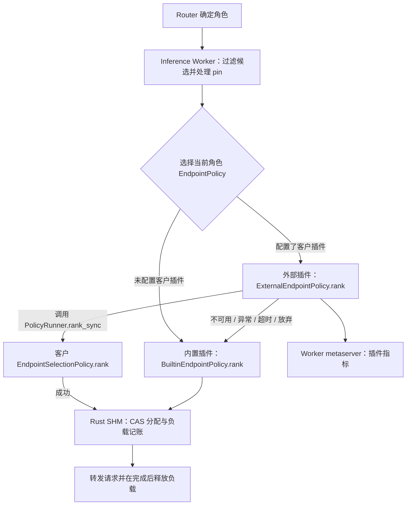
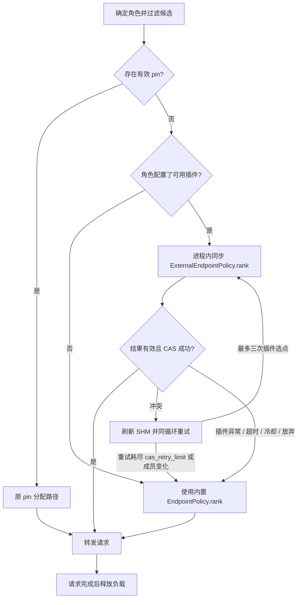

# Coordinator 自定义选点插件设计

## 背景与目标

MindIE Motor 提供轮询、负载均衡、KV 亲和和动态分桶等内置选点策略。用户需要自定义算法时，修改 Motor 核心代码会增加交付和升级成本。

本设计通过独立插件扩展角色内的候选实例和 endpoint 排序，并与内置策略插件共用同一条 Worker 进程内调度主路径，目标如下：

- **独立交付**：将算法打包为 Python wheel，通过配置启用，无需修改 Motor 源码。
- **按角色配置**：Prefill、Decode、Union 和 Encode 可分别使用插件或内置策略。
- **统一无锁热路径**：外部插件与内置策略共享相同的候选过滤、进程内同步 `rank()` 选点、Rust SHM CAS 分配与释放路径，唯一区别仅为各自内部的 `rank()` 排序算法，彻底消除跨进程 IPC 开销与高并发下的单飞静默旁路。
- **故障回退与异常隔离**：插件加载失败、排序异常、输出非法、触发极端异常或超时时，记录清晰日志并进入冷却，当前角色自动回退到原配置的内置策略。
- **保持核心约束**：Motor 继续负责候选过滤、最终分配、负载记账与释放。
- **便于观测**：通过 Worker 日志和指标查看插件加载、调用与回退情况。

插件仅对 Router 已确定角色的候选池排序，不负责混部与 PD 分离之间的拓扑选择。显式指定实例、精度探针和有效的会话亲和 pin 优先，不调用插件。

## 设计概述

### 架构与职责



| 组件 | 职责 |
|------|------|
| Router | 确定请求的拓扑和角色。 |
| Inference Worker | 过滤候选、处理 pin、通过统一 `EndpointPolicy` 选点，并执行 CAS 分配和负载释放。 |
| 内置选点插件 | `round_robin`、`load_balance`、`kv_cache_affinity`、`dynamic_bucket` 实现 `BuiltinEndpointPolicy`。 |
| `ExternalEndpointPolicy` | 实现 `BuiltinEndpointPolicy` 接口，复用统一调度路径，内部委托 `PolicyRunner` 执行客户算法，异常或回退时直接委托对应内置插件。 |
| `PolicyRunner` | 管理对应角色的进程内插件实例、线程预加载、超时/异常隔离、冷却恢复和指标。 |
| 客户插件实现 | 在 Inference Worker 进程内同步执行 `EndpointSelectionPolicy.rank()`，返回候选排序。 |
| Rust SHM | 保存负载与成员状态，通过 CAS 完成原子分配。 |
| Worker metaserver | 暴露该 Worker 的插件指标。 |

每个 Worker 按配置了客户插件的角色分别创建独立的 `PolicyRunner` 和插件对象实例（最多四个角色）。即使多个角色使用同一个插件名，也不共享插件对象、冷却状态或统计计数。Mgmt 和 Obs 不加载客户插件。

### 内置与外部插件统一路径

Worker 内置注册表按策略名提供 `round_robin`、`load_balance`、`kv_cache_affinity` 和 `dynamic_bucket` 四个进程内插件，实现 `BuiltinEndpointPolicy`。配置了客户插件的角色通过 `ExternalEndpointPolicy(runner, builtin_fallback)` 接入完全相同的选点与 CAS 仲裁主路径：

1. **统一入口与候选准入**：均经过 `_select_endpoint_candidates_with_policy()` 与 `_filter_selection_instances()` 完成引擎类型、dispatch 能力及优先级准入过滤。
2. **唯一差异在 `rank()`**：内置策略直接在 Worker 内存数据结构上计算排序；`ExternalEndpointPolicy.rank()` 先执行 `runner.is_available()` 快速预检（冷却/未就绪时零快照分配直接回退），再构建公开只读 `SelectionInput` 快照并同步调用 `runner.rank_sync(selection)`。
3. **统一 CAS 分配与重试**：两者共用同一 SHM CAS 循环（无 `asyncio.Lock` 串行槽，零 `busy` 静默旁路）。CAS 冲突（`STATUS_CHANGED` / `STATUS_BLOCKED` / `STATUS_SLOT_INVALID`）时，刷新本地 SHM 缓存后，外部插件直接在进程内重新调用 `rank()`（最多三次，耗尽则记录 `cas_retry_limit` 并在同循环内无缝切回内置策略）。
4. **统一记账语义**：客户插件成功选点时使用标准角色负载需求（`calculate_demand_workload`）；若在首轮或 CAS 重试期间回退内置策略，则立即使用对应内置策略的 `prepare_candidates()` 与 `calculate_demand()`（例如 `round_robin` 的零增量与 `dynamic_bucket` 的桶内负载计算）。

| 内置插件 | 候选与回退 |
|----------|-----------|
| `round_robin` | 使用 Worker 的角色轮询计数和起始偏移选择实例，再选择 endpoint。 |
| `load_balance` | 复用现有负载打分与 Decode KV 用量惩罚，缺少候选时回退轮询。 |
| `kv_cache_affinity` | 保留 Conductor 查询、命中率门槛及 CAS 所需的命中信息。无法按亲和选点时回退负载均衡。 |
| `dynamic_bucket` | 按请求长度选择桶，将桶内候选交给核心按实时负载重选，无法分桶时回退负载均衡。 |

### 客户插件接口

插件继承抽象基类 `EndpointSelectionPolicy`，声明 `api_version = 2`，并实现同步方法 `rank(selection)`。基类定义候选排序契约，具体算法由插件提供。构造参数 `options` 来自配置。
API v2 草案中的 `LoadBalancingPolicy` 仍可作为兼容别名导入。

| 输入或输出 | 主要内容 |
|------------|----------|
| `SelectionInput.request` | 请求 ID、角色、模型、token 数及可选 user/session 元数据。 |
| `SelectionInput.candidates` | 候选 ID、endpoint 和实例负载、地址、引擎类型及可用的 KV 缓存使用率。 |
| `SelectionInput.excluded` / `attempt` | 已排除的候选 ID，以及从 0 开始的本次选点次数。 |
| `RankedCandidate` | 候选 ID 和用于日志观测的有限数值 `score`；列表顺序表达优先级。 |

插件可返回 `None` 主动放弃本次请求，Worker 立即使用内置策略，插件实例保持健康继续服务后续请求。返回列表时须非空，元素须为 `RankedCandidate`，ID 必须来自本次候选、不能重复或属于排除集合，且分数须为有限数值。Motor 尝试列表首项，CAS 冲突时刷新 SHM 快照并重新评分。非法返回值或异常按插件错误处理。

候选数据是只读快照，不提供可写 SHM 句柄；`node_address` 是 endpoint IP，不一定代表物理宿主机。user/session 是请求元数据，不是认证身份。插件私有状态不会跨 Worker、角色或进程重启共享。

内置和客户策略共用角色候选池上的引擎类型、dispatch 能力及优先级准入过滤。快照还会排除熔断实例、被阻塞或已失效的共享内存槽位和本轮排除项，核心在提交前再次验证候选。

### 配置与加载

在 `motor_coordinator_config.scheduler_config` 下使用 `policy_plugin` 列表配置插件。每项通过 Entry Point 名称匹配已安装的插件，并指定一个或多个角色。

| 字段 | 默认值 | 说明 |
|------|--------|------|
| `role` | 必填 | 非空数组，可选 `prefill`、`decode`、`union`、`encode`。每个角色只能出现一次。 |
| `name` | 必填 | 非空 Entry Point 名称，最多 128 个字符，必须精确匹配。 |
| `options` | `{}` | 可 JSON 序列化的插件参数，不允许 NaN 或 Infinity。 |
| `timeout_ms` | `50` | 单次同步 `rank()` 执行的耗时预算（毫秒），范围 1–60000。超出后记超时、告警并进入冷却。 |
| `startup_timeout_ms` | `5000` | 启动预加载（`asyncio.to_thread`）的等待预算，范围 1–60000 毫秒。 |
| `cooldown_seconds` | `30` | 插件故障或超时后的恢复冷却时间，至少 1 秒。 |

未配置 `policy_plugin` 或设置为 `[]` 时，不加载客户插件，直接按角色使用内置策略。`null`、未知字段、重复角色或非法预算会导致配置校验报错。修改插件包或配置后，需重启相关 Worker。

Union 和 Encode 必须显式配置，不继承 Prefill 插件。

## 关键流程

### 1. 插件加载

1. 用户将插件 wheel 安装到 Inference Worker 使用的 Python 环境，并配置插件名称和角色。
2. Worker 启动时，按角色创建 `PolicyRunner`，并通过 `asyncio.to_thread` 并发预加载各角色插件（受 `startup_timeout_ms` 约束，不阻塞事件循环）。
3. 加载器按名称查找唯一 Entry Point（`mindie_motor.scheduling_policies`），校验接口版本与同步 `rank()`，然后构造插件实例。
4. 加载成功打印 `Scheduling plugin loaded ... mode=in_process`；加载失败或超时则打印明确日志、回退内置策略，并在冷却期满后触发后台恢复。

### 2. 请求选点与分配

1. Router 确定请求角色；Worker 同步刷新本地 SHM 视图。
2. 存在显式 pin 或有效会话亲和 pin 时，直接走原有 pin 分配路径；否则查找当前角色对应的 `EndpointPolicy`（外部插件或内置策略）。
3. 过滤候选后在事件循环内同步调用 `policy.rank()`；`ExternalEndpointPolicy` 构造快照并执行同步 `rank_sync()`，无跨进程通信及锁等待。
4. 校验选点结果并执行 Rust SHM `cas_add`；若出现 CAS 冲突（如多 Worker 并发写同一热点），刷新 SHM 后同循环内重试（外部插件最多重排三次，超过记 `cas_retry_limit` 转内置权威重选）。
5. 分配成功后转发请求；请求完成时，核心按已提交的负载释放资源。



### 3. 异常隔离、故障回退与边界

| 场景 | 处理方式与可观测日志 |
|------|----------------------|
| 角色未配置插件 | 直接使用该角色的内置策略。 |
| 启动加载失败或超过 `startup_timeout_ms` | 记 `load_errors` 与冷却时间；打印 `WARNING`（含 `name`/`role`/`reason`/`cooldown_seconds`），回退内置策略。 |
| `rank()` 抛出一般异常或返回非法结果 | 捕获异常、记 `errors` 与 `plugin_error`；打印 `WARNING`（含 `name`/`role`/`req_id`/`reason`/`elapsed_ms`/`cooldown_seconds`），进入冷却并回退内置策略。 |
| 极端 Python 异常（`SystemExit` / `RecursionError` / `MemoryError`） | 由 Worker 捕获隔离（避免直接退出 Worker 进程）；打印 `ERROR` 级告警并进入冷却，当次与冷却期请求全部自动回退内置策略。 |
| 单次 `rank()` 执行耗时超过 `timeout_ms` | 记 `timeouts` 与 `timeout`；打印 `WARNING` 告知本次同步调用阻塞了事件循环及实际耗时 `elapsed_ms`，放弃结果并进入冷却，回退内置策略。 |
| 处于冷却期 | 快速预检直接返回不可用（零快照开销），记 `cooldown` 并执行内置策略；冷却到期后由后台任务 `asyncio.to_thread` 重试加载。 |
| 插件返回 `None` | 记 `declined`，仅本次请求回退内置策略，保留插件实例且不进入冷却。 |
| Worker 关闭 | 取消后台恢复任务并清理插件实例；关闭期间访问按 `unavailable` 回退，不计作插件错误或超时。 |
| 真正死循环或 C 扩展段错误（边界说明） | 进程内同步执行不依赖 POSIX 子进程强杀；此类不可捕获异常会卡死或崩溃当前 Worker 进程，需由 Coordinator `SubprocessSupervisor` / 健康探针隔离重启，并检查插件自身实现。 |

Prefill、Union 和 Encode 使用 `prefill_scheduler_type` 作为默认和回退策略；Decode 使用 `decode_scheduler_type`。删除插件配置并重启 Worker 可恢复内置路径。

客户插件成功选点时接管该角色的候选排序，内置 KV 亲和和动态分桶仅在回退时执行。客户插件路径不发出内置 Conductor 亲和查询，`scheduled` 的 `matched` 和 `hit_rate` 为 `None`。

### 4. 日志与指标

Worker 日志记录插件加载、故障、极端异常、慢调用和选点结果。插件选点成功时，`scheduled` 日志中的策略名为 `plugin:<name>`。
客户插件请求的 `plugin_attempt` 表示成功分配前的排序轮次，从 1 开始。`proposed` 保留首次选点，用于比较最终选点是否改变；`fast_path` 为 `not use_authoritative`（首轮未经历重试重扫时为 `True`，重试后为 `False`）。

Worker metaserver 的 `GET /metrics` 按 `{policy,role}` 暴露指标：

| 指标 | 含义 |
|------|------|
| `motor_policy_loads_total` / `motor_policy_load_errors_total` | 加载成功 / 失败次数。 |
| `motor_policy_calls_total` | 插件排序调用次数，包含 CAS 重选。 |
| `motor_policy_errors_total` / `motor_policy_timeouts_total` | 排序错误 / 超时次数。 |
| `motor_policy_fallbacks_total` | 插件路径回退次数，不等同于请求失败次数。 |
| `motor_policy_fallbacks_by_reason_total` | 按 `reason` 标签细分回退：包含 `unavailable`、`cooldown`、`declined`、`timeout`、`plugin_error`、`no_eligible_candidates`、`membership_changed`、`cas_retry_limit`、`snapshot_error` 等（保留 `busy` 与 `invalid_input` 标签且值恒为 `0` 以兼容看板）；未知原因也会导出并记录 WARNING。 |
| `motor_policy_selection_seconds_sum/count` | 插件排序调用的累计耗时和次数。 |

指标属于各 Worker，Obs 不自动汇总。默认抓取端口为 `worker_metaserver_base_port + worker_index`；设置基准端口为 `0` 时关闭该抓取口。调用次数可能包含重选，不能直接作为请求数。

## 场景介绍

### 示例插件

[快速接入指南](../user_guide/features/inference_scheduling/scheduler_policy_plugin.md)中的示例注册了 `mycompany.least_load`，按以下公式从小到大排列候选：

```text
endpoint 负载 + instance_weight × 实例负载
```

同分时按实例 ID 和 endpoint ID 排序。

### 配置示例

将插件安装到所有相关 Worker 的 Python 环境后，在已有 `user_config.json` 的 `motor_coordinator_config.scheduler_config` 中加入：

```json
{
  "policy_plugin": [
    {
      "role": ["prefill", "decode"],
      "name": "mycompany.least_load",
      "options": {"instance_weight": 0.05},
      "timeout_ms": 50
    }
  ]
}
```

此配置让 Prefill 和 Decode 复用配置，但两者分别运行独立插件实例。如需不同参数，可拆成两个配置项；混部场景需显式添加 `union`。配置并重启后，查看 Worker 的 `Scheduling plugin loaded` 日志，再发送请求检查 `scheduled` 日志和插件指标。

从编写、打包到部署验证的完整步骤见[自定义选点插件快速接入](../user_guide/features/inference_scheduling/scheduler_policy_plugin.md)。

### 旧单对象配置迁移

旧草案使用单对象和 `roles` 字段，需要改为列表和 `role` 数组：

```json
{
  "policy_plugin": [
    {"role": ["prefill", "union"], "name": "mycompany.least_load", "options": {"instance_weight": 0.05}}
  ]
}
```

禁用某角色时，从 `role` 数组移除该角色；数组为空时删除整个配置项。旧单对象格式会报迁移错误，不会自动转换。

### 常见使用场景

| 场景 | 配置或操作 | 预期 |
|------|------------|------|
| 不使用插件 | 省略 `policy_plugin` 或设为 `[]`。 | 不加载外部插件，使用现有内置策略。 |
| P/D 共用算法 | 在一项中设置 `role: ["prefill", "decode"]`。 | 两个角色使用相同配置，各自独立实例运行。 |
| P/D 使用不同参数 | 为 P、D 分别添加配置项，设置各自的 `name` 或 `options`。 | 各角色调用对应插件和参数。 |
| 某角色插件失败 | 检查该角色的日志与 `fallbacks` 指标。 | 故障角色回退，其他角色继续独立运行。 |
| 停用插件 | 删除相应角色配置并重启 Worker。 | 该角色恢复使用内置策略。 |

## 相关代码与验证

| 路径 | 作用 |
|------|------|
| `motor/config/coordinator.py` | 插件配置及角色校验。 |
| `motor/coordinator/scheduler/policy/api.py` | 插件接口和数据结构。 |
| `motor/coordinator/scheduler/runtime/builtin_endpoint_policy.py` | 内置选点插件与 `ExternalEndpointPolicy` 统一接口层。 |
| `motor/coordinator/scheduler/policy/plugin_runner.py`、`plugin_worker.py` | Entry Point 加载、同步执行、超时/异常隔离、冷却与指标。 |
| `motor/coordinator/scheduler/runtime/scheduler_client.py` | 统一策略路由、SHM CAS 分配与重试回退。 |
| `tests/coordinator/scheduler/test_policy_plugin.py` | 插件契约、高并发零旁路、异常隔离、CAS 分配和指标测试。 |

运行专项测试及调度、配置回归：

```bash
bash tests/run_tests.sh --serial tests/coordinator/scheduler/test_policy_plugin.py
bash tests/run_tests.sh --serial tests/coordinator/scheduler/ tests/coordinator/core/test_config.py tests/config/
```

上述单测与集成用例用于功能验证（插件契约、并发无旁路、故障隔离、分配释放及指标计数）；原生用例需要可加载的 Rust SHM 库，使用 `/dev/shm` 的用例需要 Linux。

相关设计：[Coordinator 调度热路径 Rust 重构](coordinator_scheduler_rust.md)、[KV Conductor](kv_conductor.md)、[熔断设计](circuit_breaker_design.md)。需求见 [Issue #844](https://gitcode.com/Ascend/MindIE-Motor/issues/844)。
